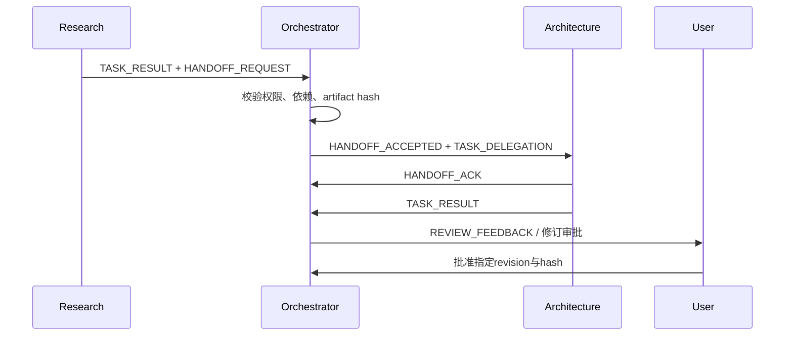

# Agent 通信协议
所有消息经过编排器；本机数据库消息与函数调用足够，不引入broker。消息不是任意跨Agent共享聊天历史。

```json
{"schema_version":2,"message_id":"uuid","run_id":"uuid","task_id":"architecture","sender":"research@1","receiver":"architecture@1","message_type":"HANDOFF_REQUEST","payload":{"artifact_ids":["uuid"],"reason":"研究完成","scope_id":"design"},"timestamp":"2026-11-14T04:00:00Z","correlation_id":"uuid","causation_id":"uuid","plan_revision":1}
```

类型枚举：TASK_DELEGATION、HANDOFF_REQUEST、HANDOFF_ACCEPTED、HANDOFF_ACK、TOOL_CALL、TOOL_RESULT、TASK_RESULT、REVIEW_FEEDBACK、CONTROL_EVENT。payload按message_type判别联合Schema，未知类型拒绝；控制事件仅runtime发送，模型不能伪造sender。task_id对run级控制事件允许null。

TASK_RESULT携artifact_id/hash/output_schema_id；REVIEW_FEEDBACK携verdict/findings/criterion_ids；TOOL_CALL携operation_id/tool_version/args_redacted/args_hash；完整敏感参数不广播。消息写入与对应业务状态、event同事务，message_id唯一幂等。correlation_id串起委派与响应，causation_id指直接原因。


共享仅任务规格、验收与授权artifact；私有prompt、凭据、无关聊天不共享。数据引用跨run默认禁止。消息上限64KiB，成果1MiB，超限转artifact或报错；事件不能承载完整模型上下文。传输至少一次，接收方按message_id去重，不声称外部副作用exactly-once。
