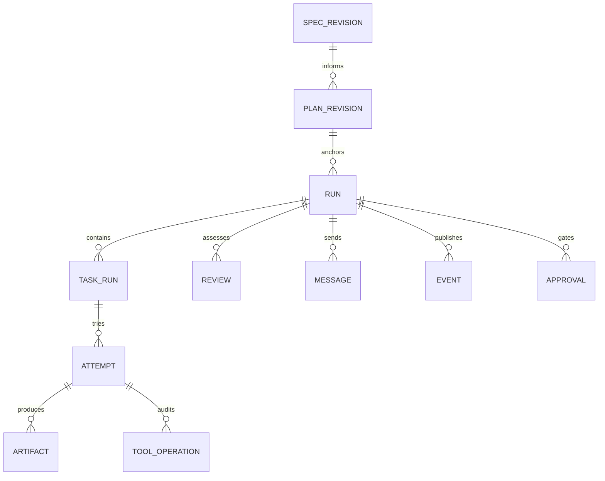

# 业务数据库

SQLite 与 SQLAlchemy/Alembic。连接启用 foreign_keys、WAL 和短事务，网络调用在事务外。schema_version 通过迁移管理，API 契约见[工作流数据](WORKFLOW_DATA_MODEL.md)。

| 表 | 键与约束 |
|---|---|
| specs / spec_revisions | spec_id 与不可变 revision，唯一组合，JSON 规格 |
| plans / plan_revisions | plan_id 与 revision 唯一，绑定 spec_revision_id，包含 hash 与定义 JSON |
| runs | id、plan_revision_id、active_revision_id、graph_version、mode、status、generation、last_seq、预算与时间 |
| task_runs / attempts | (run_id,revision_id,task_id) 唯一，attempt_number 唯一于 task_run；记录输入清单、角色版本和耗时 |
| artifacts / reviews | 成果 attempt FK 与 hash，审查 run/revision FK、verdict、证据与缺陷 |
| events / messages | (run_id,seq) 复合主键；消息按 message_id 去重 |
| approvals / commands | 审批状态与 hash 的 CAS；命令按 scope/key 唯一，保存 request_hash 与结果 |
| tool_operations | operation_key 唯一，attempt FK、tool_id、状态、脱敏参数摘要 |
| layouts | plan_revision_id、坐标、注释和 viewport，与计划定义分离 |

状态、审批、成果、消息与相应可见事件同事务提交。领取通过条件更新避免双发，使用 generation 阻止终态后写回。索引按 run/status、revision 与事件顺序查询。数据库可独立导出脱敏证据。重启只恢复可读历史和失效标记，持久 checkpoint 后置。备份使用 SQLite backup，恢复后检查完整性，数据库文件不入 Git。

