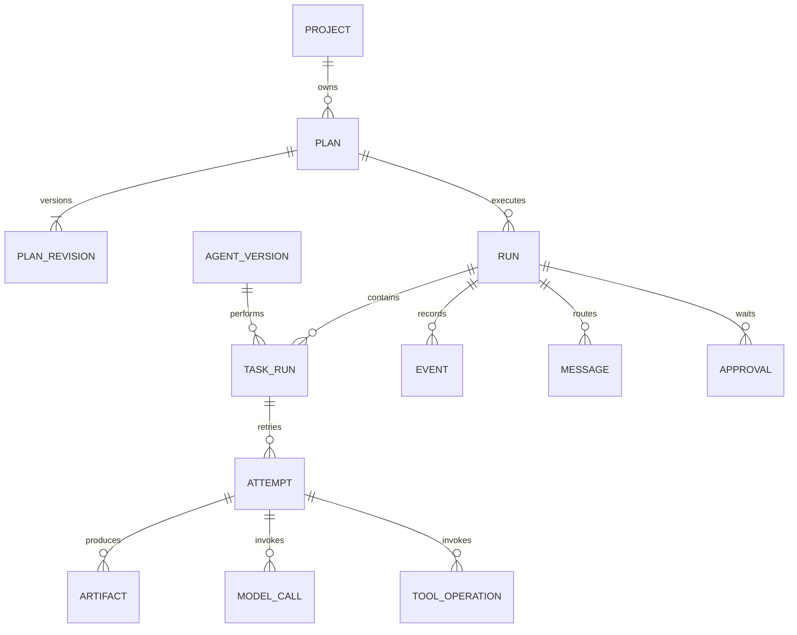

# 数据库设计
业务flowstudio.db与checkpoints.db分离，SQLAlchemy/Alembic管理业务schema；checkpoint表由锁定版本官方SQLite saver管理，不手工改其表。WAL、foreign_keys=ON、busy_timeout与短事务；模型网络请求不持有数据库事务。业务写入统一串行入口，CAS/唯一约束仍必须具备。

| 表 | 关键字段与约束 |
|---|---|
| projects | id PK,name,deleted_at |
| agents / agent_versions | agent_id FK,version；UNIQUE(agent_id,version)，definition_json不可变 |
| model_profiles | id,version,base_url,model_name,secret_ref,capabilities_json |
| plans / plan_revisions | plan_id FK,revision,definition_json,layout_json,hash；UNIQUE(plan_id,revision) |
| runs | id,plan_id,active_revision,status,generation,scheduling_paused,mode,thread_id UNIQUE,graph_version,budget_json,next_seq,planning_run_id |
| task_runs | id,run_id,task_id,revision,status,current_attempt_id；UNIQUE(run_id,revision,task_id) |
| attempts | id,task_run_id,number,token,status,input_hash,started_at,deadline_at,error_json；UNIQUE(task_run_id,number) |
| artifacts | id,attempt_id,schema_id,content_json,sha256,created_at；不可变 |
| messages | message_id PK,run_id,task_id,type,payload_json,correlation_id,causation_id |
| events | run_id,seq,type,payload_json,timestamp；复合PK(run_id,seq) |
| approvals | id,run_id,task_id,kind,target_hash,revision,status,expires_at,decision_json；决定CAS |
| tool_operations | operation_key UNIQUE,attempt_id,tool_version,args_hash,status,result_ref,side_effect_class |
| model_calls | id,attempt_id,request_key UNIQUE,profile_version,provider_request_id,usage_json,usage_quality,status |
| commands | idempotency_key,scope,request_hash,response_json；UNIQUE(scope,idempotency_key) |

JSON列必须json_valid，服务层严格schema；状态CHECK枚举；外键默认RESTRICT，删除历史使用显式事务，不能级联误删证据。索引events(run_id,seq)、task_runs(run_id,status)、approvals(status,expires_at)、runs(status,created_at)。追加artifact引用同时校验同run与hash。

claim事务写attempt/状态/预算预留/event；完成事务校验token/generation后写artifact/结果/message/event；审批事务CAS+decision+event；修订事务创建版本/切换active_revision/失效关系/event。不同库不做伪分布式事务，恢复协议见STATE_MANAGEMENT。

运行数据默认保留30天，固定记录不自动删除；清理仅终态、先预览用户确认。日志脱敏10MiB×5轮转；event不存token流逐字，只批量摘要与重要状态。备份需停止调度并等待写入静止，分别SQLite backup两库并记录同一manifest及graph/schema版本；恢复先停止后端、完整性检查并按恢复协议对账。不要直接复制活跃WAL数据库。迁移前备份，代码不兼容新schema时拒绝启动；不承诺任意降级。
