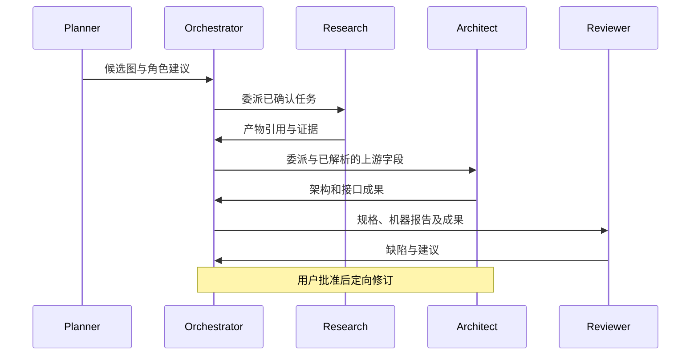

# 多 Agent 角色与协作

| 内置角色 | 输入和上下文 | 成果 Schema | 工具 |
|---|---|---|---|
| Planner | 固定规格、能力目录、计划约束 | PlanRevision 候选 | 无 |
| Research | 规格、明确授权的项目材料 | constraints、assumptions、findings、source_refs | 允许的本地材料只读 |
| Architect | Research artifact、规格 | modules、schema、api、decisions | JSON 校验 |
| Planning | 架构与规格 | development_tasks、dependencies、criterion_refs | JSON 校验 |
| TestDesign | 架构与规格 | cases、criterion_refs、expected_results | JSON 校验 |
| Reviewer | 规格、各成果和机器检查 | verdict、findings、evidence_refs | JSON 校验 |

AgentRegistry 用角色 ID 与版本注册预设，配置独立 system_prompt、model_profile_ref、input_schema、output_schema、allowed_tools、max_steps 和上下文预算。运行冻结配置，不含 API Key。多个角色可共享 DeepSeek 连接。Agent 仅见当前任务、设计规格必要片段和绑定成果。工具输出按不可信输入处理，不能更改提示权限。没有检索工具时 Research 标明材料来源与未验证假设。

Planner 提出分工，编排器核对角色能力后派发。专职 Supervisor 和 Writer 无首版必要。交接时由编排器接受生产成果，验证引用并向接收角色发任务委派，接收方的 Attempt 清单证明实际消费；当期不实现任意控制权转移。Reviewer 的缺陷交回对应角色，批准后才运行。消息、依赖、成果、工具操作及状态事件分开记录，见[通信协议](AGENT_COMMUNICATION.md)。

