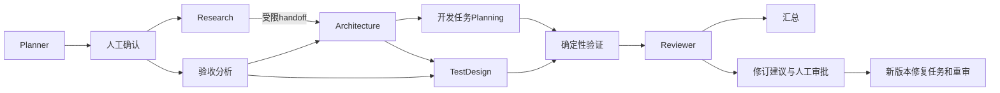

# 编排引擎
## 固定主图与动态计划
主图版本与run绑定：load→validate→approval→dispatch→worker(Send fanout)→collect→dispatch；所有必需任务完成后verify→review→finalize，review可进入revision_approval→修订调度。计划是数据，不是动态Python代码；task_id与React节点一一对应，Agent可在多个任务复用。主图节点和画布任务节点不是一一对应。

PlanRevision契约：schema_version=2、plan_id、revision、goal、constraints、tasks、dependencies、handoff_rules、budget。TaskSpec含task_id/title/agent_version_ref/instructions/input_bindings/output_schema/acceptance/required/timeout_s；binding含source_task_id/artifact_key/json_pointer/required/fallback。Dependency含source/target/condition（always或白名单结构化比较）。禁止eval。layout独立含positions/groups/viewport。

严格校验：拒绝未知字段；ID唯一且引用存在；DAG拓扑排序；角色/工具可用；必需输入来自依赖祖先且字段类型兼容；必需输出有验收条件；条件引用只读已完成输出；条件可能跳过时必需输入必须有fallback或拒绝计划；任务数、预算、schema深度及大小限制。规划JSON失败返回字段路径给Planner，最多2次修复后FAILED(PLAN_INVALID)，保留原文脱敏副本。

## 调度算法
依赖边状态UNRESOLVED/SATISFIED/INACTIVE/FAILED。源完成后求值条件，选中SATISFIED，否则INACTIVE；所有入边resolved且至少一条SATISFIED、所有required bindings可解析时READY。无入边为根任务；全部INACTIVE则SKIPPED并传播；存在FAILED则BLOCKED并传播。必需任务SKIPPED不能令整体完成，除非计划明确其是条件可选任务。

每轮按拓扑序+task_id稳定选最多空闲槽数的READY任务，用Send派发给通用worker；LangGraph超级步在本轮任务完成后合流，P0接受慢任务阻塞下一轮的吞吐代价，P1再优化。reducer以(task_id,attempt_id)合并不可变结果，相同键不同hash视为冲突；不要并行覆盖messages或共享字典。应用只负责业务就绪判定/配额，复用LangGraph并行和checkpoint，禁止再实现第二套协程图引擎。

claim短事务校验run generation/暂停/预算、创建唯一attempt。结果提交须校验attempt token与generation；晚到结果记录但不改变已取消终态。单分支失败允许其他独立分支完成，失败下游BLOCKED；没有ready/running/合法等待且仍有pending时失败DEADLOCK。最终缺少必需输出则FAILED；可选分支失败显示警告并进入审查。

## 真正的handoff
Research输出handoff_request(target=Architecture,artifact_ids,reason,scope)；Coordinator可建议目标；编排器检查允许边、源已完成、目标未启动、依赖齐全、权限不扩张，在事务中更新该协作线程active_agent与handoff记录，再派发目标。目标输入必须引用相同artifact hash，并输出ack。请求/接受/执行三类事件完整留存。仅画一条依赖线不算交接；并行分支各自有scope_id，不争抢全局单一active_agent。

## 修订与终止
P0只支持Reviewer发现缺陷后追加修复任务和一次演示重审；协议上最多2次。P1允许Planner提交局部patch：新增/替换未开始任务，已经完成/执行中任务不修改；受影响下游失效需创建新task版本并重新计算，不覆写成果。先停止新调度、等待在途任务收敛，基于revision做CAS；展示diff/预算/下游失效范围，人工批准后创建PlanRevision并切换active_revision。旧任务记录保留SUPERSEDED关系（元数据，非运行状态）。拒绝则FAILED(REVIEW_REJECTED)，保留部分成果。新增任务不得扩权；所有重试/修订消耗同一run预算，达到限额转FAILED或人工结束，不自动扩额。

