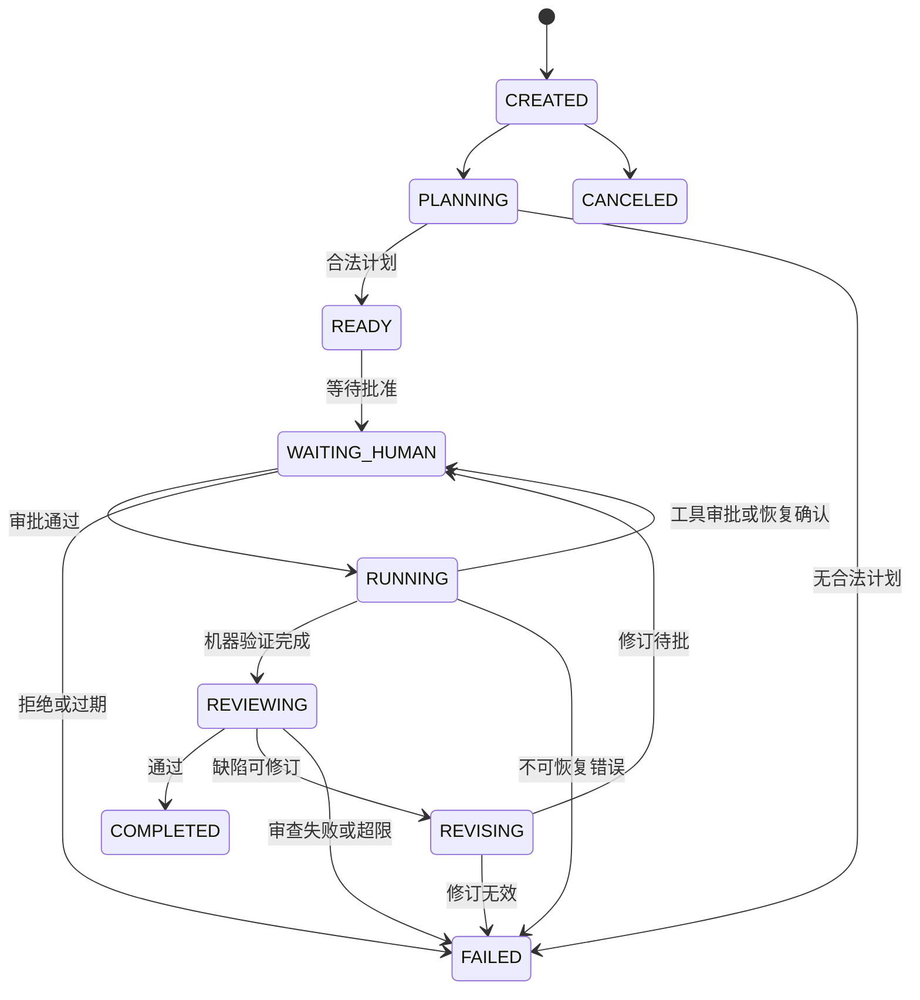

# 状态与持久化

取消适用于全部非终态；图只画一次代表边，状态表以此规则为准。所有终态不可恢复为活动态，重跑新建run。Run只有无活动工作且确需人工时WAITING_HUMAN，局部任务审批不阻塞其他可执行分支。手动计划CREATED→READY。

TaskRun：PENDING→READY→RUNNING→COMPLETED；输出待审可经REVIEWING；审批进入WAITING_HUMAN；失败FAILED、依赖失败BLOCKED、条件未激活SKIPPED、用户取消CANCELED、崩溃中在途结果未知INTERRUPTED。重试创建新Attempt，历史不改；TaskRun的当前attempt指针迁移需CAS。

暂停提交scheduling_paused=true后禁止claim，已经执行的模型/工具继续直到边界；UI显示“停止新调度，在途N”。恢复清标志，仍需校验审批和预算；不是冻结网络请求。取消先generation++与cancel_requested，停止调度并尝试取消I/O，最长5秒收敛CANCELED；已发生副作用不会撤销，迟到结果单独记录。

业务库是用户可见状态、事件与结果事实源；checkpoint是LangGraph控制位置、线程状态和恢复游标。两库不存在原子事务。每个节点效果使用稳定operation_key(run/task/attempt/step)，先查业务结果；已提交则复用，未提交才执行。图推进但业务未确认不允许下一业务步骤；节点返回前必须提交业务事务。checkpoint落后导致重入时复用已提交结果；checkpoint损坏或图版本不兼容暂停恢复，不能猜测执行位置。

启动取得单实例锁→检查版本/数据库→扫描在途Attempt→标INTERRUPTED→对账checkpoint与operation记录。纯计算/已持久化结果可自动复用；模型请求无结果可能重复收费，进入WAITING_HUMAN确认重试；副作用结果未知需人工核实，不自动重发；待审批记录跨重启保留有效，检查hash/期限后用相同thread_id和Command(resume=decision)。中断节点重入前的逻辑必须幂等，interrupt前不放非幂等副作用。

SSE id为run_id:seq，业务状态与event在同事务递增seq。客户端先读取snapshot和snapshot_seq，再从该序号补事件；收到重复去重，发现缺口重新抓snapshot。Last-Event-ID支持断线续传，游标早于保留窗口返回reset事件与快照地址；流心跳15秒，慢客户端断开后补发，不阻塞调度。事件从DB分页读取，内存通知仅唤醒；连接断开不取消任务。
