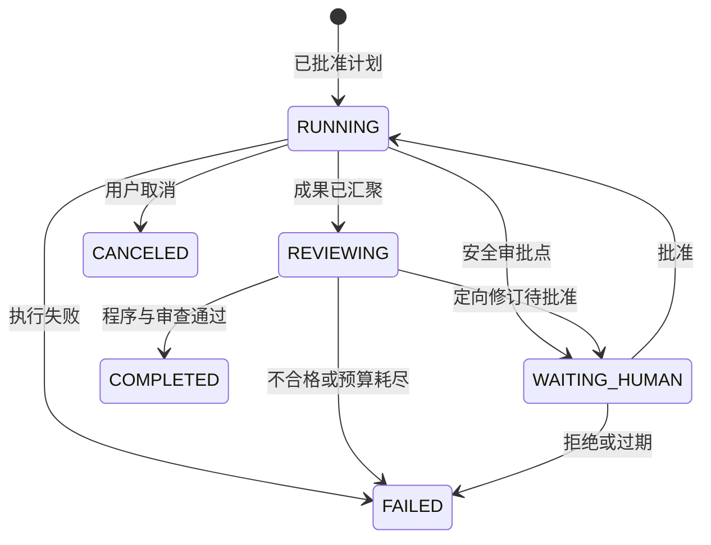

# 执行状态与恢复边界

候选计划 PLANNING/READY/FAILED 由规划端维护。执行前的确认与创建 run 是一个事务。RUNNING、REVIEWING、WAITING_HUMAN 都可接受取消。任一活动状态遭遇无法恢复的进程终止，可转 FAILED 并记录 PROCESS_INTERRUPTED。修订批准使 Run 回到 RUNNING，修订轨迹通过 revision 与事件表示。终态不可覆盖，重新运行创建新 run。

TaskRun 为 PENDING → READY → RUNNING → COMPLETED。人工任务经 WAITING_HUMAN。失败 FAILED，下游 BLOCKED，取消 CANCELED，进程中断的在途任务 INTERRUPTED。临时错误重试创建新的 Attempt，不覆盖历史。审批等待仅在在途任务收敛后进入 WAITING_HUMAN。人工作出决定时检查目标 hash、期限和当前状态，重复命令返回原结果。

取消先更新 generation 并停止领取，在途 I/O 尝试取消，最多 5 秒后收敛业务状态。晚到回调不得写成功，取消不能撤回已发送的请求或已产生的费用。状态、成果、审批和持久事件同事务。首版异常退出后将未结束 run 设为 FAILED，待决审批失效、已落库成果保留。下一次执行重新确认，P0 禁止自动重发结果未知的外部操作。

跨重启的 LangGraph SQLite checkpoint 是 P1。业务记录是 UI 事实源。接入时用稳定 thread_id、graph_version 与 operation_key 对账，checkpoint 落后则复用已提交的结果。两库不可假定原子提交，版本不兼容或结果未知需人工处理。

SSE 的 id 使用 run_id:seq。快照包含 snapshot_seq，接着补发其后的事件，再监听实时新事件。重复按 run_id:seq 去重，发现缺口重取快照。保留期外返回 reset，客户端刷新。心跳 15 秒，慢连接关闭可重连。断线不影响执行。
