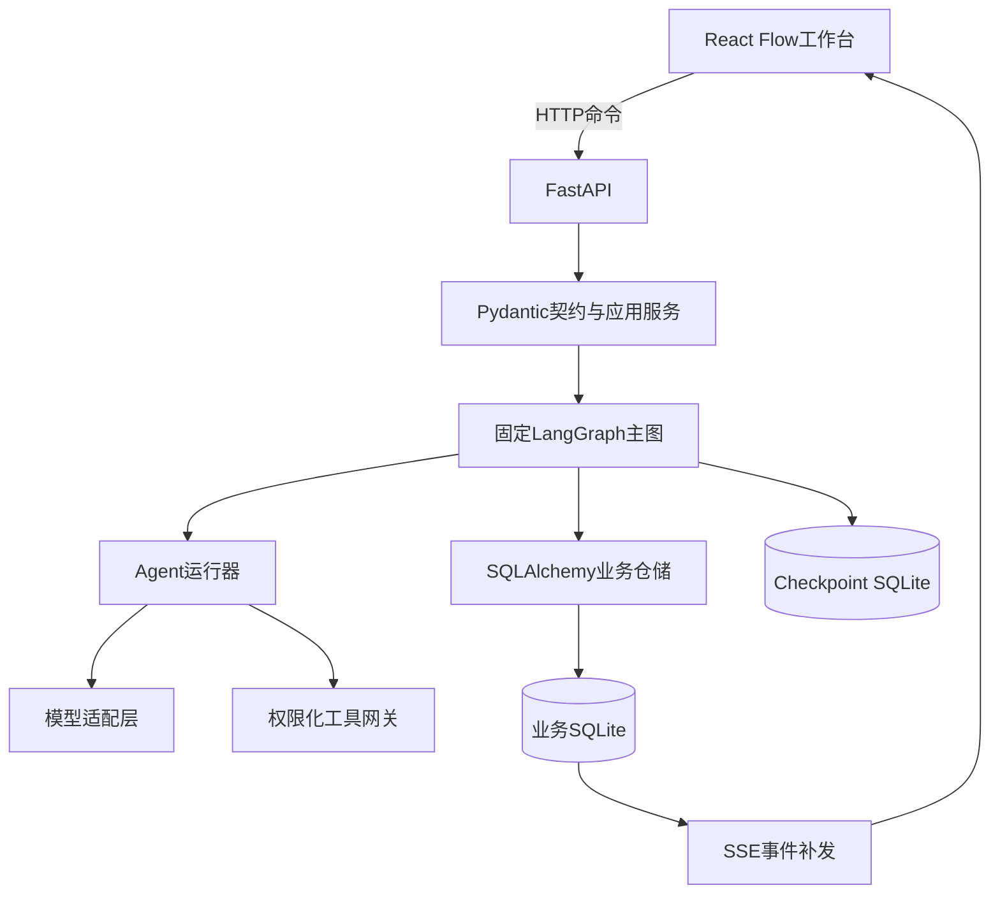

# 系统架构
遵循[基线](../BASELINE.md)。模块化本地单体；前端无法访问密钥、直接调模型或决定任务成功。

前端React+TypeScript+Vite+Tailwind+shadcn/ui；React Flow呈现TaskSpec投影，Zustand只保存草稿/选择/撤销，服务端查询缓存管理运行快照。后端FastAPI lifespan管理单个调度执行循环，LangGraph提供路由、Send并行、checkpoint和interrupt；不在HTTP请求生命周期内等待完整任务。不引入Celery。

建议目录：frontend/；backend/app/{agents,orchestration,tools,persistence,api,models}；contracts/生成的JSON Schema/OpenAPI；tests/{unit,integration,e2e,live}；docs/。Pydantic是契约唯一源，导出TS类型，CI检查生成物漂移。Agent定义是数据，不是用户可上传Python插件。

开发期Vite代理/api到127.0.0.1:8000；发布时FastAPI提供构建静态资源。仅loopback、精确Origin/Host白名单、同源会话和CSRF保护；不使用CORS星号。后端数据目录默认本机.flowstudio且Git忽略，不能使用网络共享SQLite。独占数据目录锁防多进程启动。

## 接口约定
POST /api/plans: goal/spec/mode→规划run；GET /api/plans/{id}返回revision与任务；PATCH携带expected_revision，冲突409；POST /validate返回{code,path,task_id,message}；POST /approve携带plan_hash、revision、idempotency_key；POST /runs冻结审批快照。规划run和执行run通过planning_run_id关联，规划预算单独记录，用户可配置项目总预算。
GET /runs/{id}返回snapshot_seq和完整状态；GET /runs/{id}/events支持Last-Event-ID；POST /pause、/resume、/cancel与/approvals/{id}/decision均有幂等键。Agent CRUD创建新版本；DELETE仅停用。错误封装code/message/details/correlation_id，校验422、冲突409、过期410、预算或能力不足返回明确业务码。

## 模型适配
ModelProfile含base_url、secret_ref、model_name、timeout、retry_policy及capabilities（json/tool/temperature/context限制）；Agent只引用profile版本。调用统一为request(messages,output_schema,allowed_tools,budget)→content/tool_calls/usage/provider_request_id。能力不支持则禁用参数，不盲传temperature。DeepSeek按用户配置端点，先连接测试与结构化输出探针；不把兼容OpenAI协议当成所有功能等价。Token统计优先provider usage，估算单独标记；费率由带日期配置换算，未知价格不猜测。

密钥存Windows凭据管理器，业务库仅secret_ref；日志请求头脱敏，导出禁止密钥；环境变量供开发但不写Git。发送前原子预留请求数和最大输出token预算，结束结算；超时usage未知保留预留，防并发绕过上限。

## 工具系统
注册tool_id/version、输入输出schema、scope、timeout、side_effect_class、idempotency支持。权限为run授权与Agent白名单交集，每次调用及恢复前重新验证。文件只读限定用户授权根目录，解析真实路径并拒绝越界/链接跳转；HTTP限定域名/协议，验证DNS及每次重定向，阻止私网与元数据地址，响应限额1MiB，默认GET。文本与JSON工具纯计算。副作用工具需批准精确参数hash，变参作废；不开放任意shell或自由写路径。工具结果视为不可信数据，不能授予权限。
