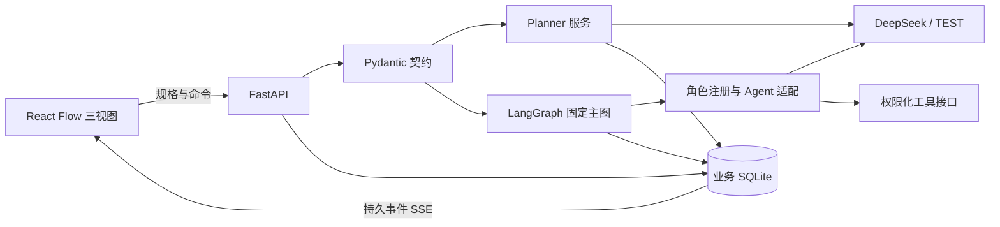

# 系统架构

一个 FastAPI 进程拥有调度和数据库写入。React Flow 只投影视图和编辑草稿。规格保存、规划命令、审批、取消与状态查询走 HTTP，状态变化由 SSE 推送。后端只绑定 loopback，校验来源和 Host，开发用 Vite 代理保持同源。API 不返回密钥。数据目录按实例锁避免并发启动；进程重启恢复业务数据与中断状态。

前端现有技术和样式继续使用，模块为规格、画布、运行、验证。后端建议 `backend/app/{api,agents,orchestration,models,tools,persistence}`，生成契约放 `contracts/`，测试放 `tests/{unit,integration,e2e,live}`。典型调用使用独立 Agent 上下文，统一模型适配报告结构化输出、错误、request ID 和 usage。适配层与 LangGraph 不共享传输 DTO。

SQLite 只承载本地状态、快照、产物及事件。单进程 I/O 并发足够首版需求。工具注册含版本、参数 Schema、白名单、超时、大小上限、作用域和副作用分类。首版只读材料或纯计算，禁止 Shell、任意网络访问和任意写路径。对照[选型](TECH_STACK.md)、[数据契约](WORKFLOW_DATA_MODEL.md)与[编排算法](ORCHESTRATION_ENGINE.md)。
