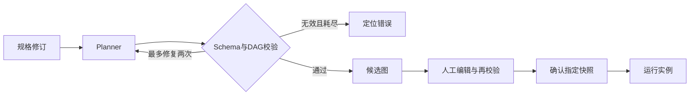

# 智能任务分解

输入为固定 SpecRevision、内置角色能力表、成果 Schema 目录及资源限制。Planner 输出 JSON 候选，严格解析后按字段结构、引用完整性、能力及图语义依次检查。运行状态由程序投影，模型提交的状态字段拒绝。输出契约见[数据模型](WORKFLOW_DATA_MODEL.md)。

校验顺序：任务与字段尺寸限制 → 任务 ID 唯一 → 角色适配输出 Schema → 依赖存在且无自环 → Kahn 拓扑排序且处理全部任务 → 输入绑定来源是已声明依赖且类型匹配 → 按验收项检查覆盖 → 确认需要的成果类型均有生产者。人工修改复用同一规则。若失败，将字段路径和错误码回传 Planner 修复，最多两次，仍失败则保留原规格与诊断。

规划结果写入候选版本。人工修改生成新版本。确认事务比较 revision/hash，保存批准记录并创建运行，后续草稿变更只影响新运行。图在执行中不自改。标准术语见[数据模型](WORKFLOW_DATA_MODEL.md)。

