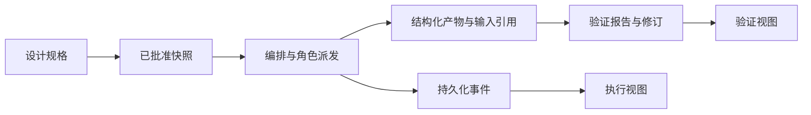

# 执行可视化与人工交互

布局复用点阵画布、紧凑节点、浮动工具栏和按需详情。顶部切换设计、执行、验证。状态用图标和文本辅助颜色。画布在运行时以已确认快照绘制，自动修订新增一个可切换版本。当前已实现画布能力见[编辑器](WORKFLOW_EDITOR.md)。

| 视图 | 用户动作 | 数据源和响应 |
|---|---|---|
| 设计 | 编辑规格与候选任务，校验，确认 | Spec/PlanRevision。确认前显示角色、依赖和约束，冲突可刷新比对 |
| 执行 | 查看路径、实际输入输出、时间线和异常，取消或处理审批 | TaskRun 与 Attempt，事件标注为什么就绪、输入来源 artifact、派发角色、用时、结果和错误。工具与 Agent 消息分筛选 |
| 验证 | 下载设计成果和报告，查看失败证据与申请修订 | 程序检查、Reviewer 缺陷、标准与 evidence_ref。展示修订范围及是否已用完额度 |

每个真实事件带序号、task_id、revision_id、attempt_id 和时间，摘要指向可按需加载的内容。未配置工具显示无工具调用。前端不生成假运行状态。SSE 断线显示最后确认时间，按序补齐再刷新视图。取消显示已停止调度及仍在收敛的请求。浏览器关闭不停止后端。

