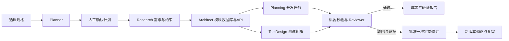

# 设计验证与测试规范

执行状态 NOT_RUN。此前 CLI 与画布单独验证不代表网页或 REAL 闭环通过。

## 学生选课管理系统

使用[学生选课规格 JSON](fixtures/course-selection.spec.json)。这是创建规格的请求样例，revision、ID 和时间由后端生成。完成条件要求 C1–C5 都有对应设计和测试。后续实现按此输入固定复现。

示例拓扑供 TEST 固定复现，REAL 允许合法等价拆分。Architect 读取 Research 的 constraints，两个独立角色实际读取同一个 Architecture 产物，输入清单记录 hash 和 JSON Pointer，Reviewer 读取汇聚后的全部成果。修订场景通过 TEST 注入漏掉 C2 的测试矩阵，同时把机器检查报告交给 Reviewer。期望指出 C2 缺陷、负责任务和证据，批准后只重做 TestDesign 与受影响的复审。REAL 可受控注入同样缺陷，证据标记测试干预。

| 用例 | 自动或人工 | 通过条件 |
|---|---|---|
| V01 规格与规划 | 单元+集成 | 拒绝缺字段、无效角色、不兼容绑定、自环、环和缺失引用；AI 格式修复最多两次 |
| V02 确认并运行 | 集成+浏览器 | 未批准不派发，旧版本 409，重复确认只建一条 run。编辑草稿不改变运行图 |
| V03 真实传递 | 集成+REAL | 至少三种独立职责的真实请求记录。下游输入含实际产物字段。改变约束，核查对应设计与测试变化 |
| V04 并行汇聚 | 集成+人工 | 两个分支调用时间重叠，任一未完成时不启动依赖双方的审查，并发不超过 2 |
| V05 失败与取消 | 集成 | 失败下游 BLOCKED，超额度终止。取消停止领取，晚到结果不改变终态 |
| V06 人工节点 | 集成+浏览器 | 审批等待无在途任务，只接受匹配 hash 的一次决定，拒绝或到期落终态 |
| V07 验证与修订 | 集成+REAL | 找出 C2 缺失，程序失败不可被模型 pass 覆盖。批准后新增 revision，保留历史。二次失败终止 |
| V08 事件一致性 | 浏览器 | 断线后补发去重，执行视图与 GET 快照一致，可查输入、输出、耗时、状态和原因 |
| V09 持久化 | 集成+Windows | 中途关闭后端再启动，旧 run 标中断且保留成果，查看历史不发模型请求 |
| V10 真实交付 | 人工+Windows | 真实 API 证据、设计成果及 C1–C5 的覆盖表可审阅。验证日志脱敏 |

实施时将规格、正常计划、缺陷产物和响应夹具提交至 tests/fixtures。计划命令为 `python -m pytest tests/unit tests/integration`、前端构建与 `npx playwright test`，最终命令由 Phase 8 记录。REAL 独立运行，Key 通过环境变量配置。每次报告保存 commit、环境与依赖版本、模式、fixture hash、plan revision、请求 ID、输入及输出 hash、事件、产物、缺陷与最终判定。模型输出按 Schema 与验收覆盖验证，无需逐字相同。
